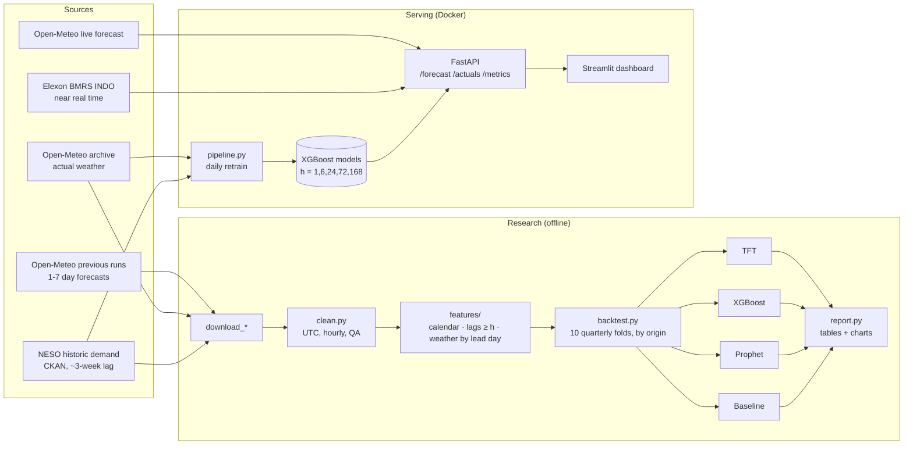
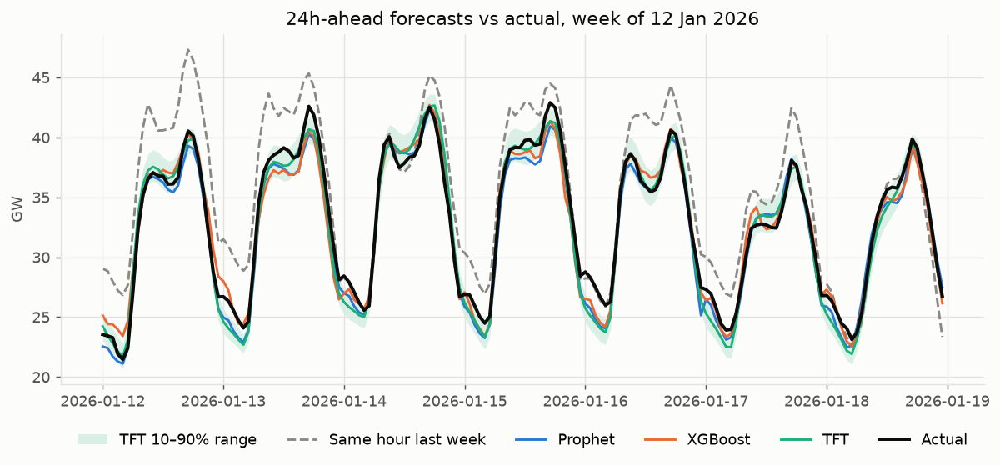
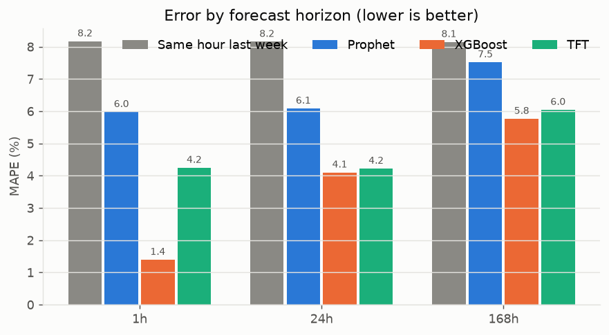
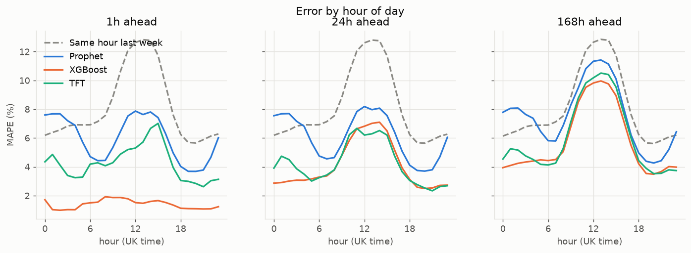
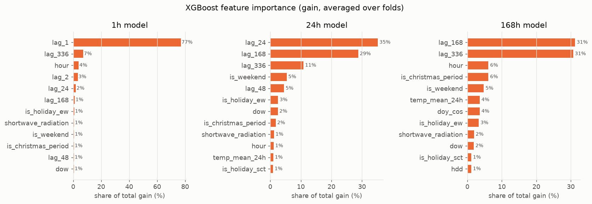
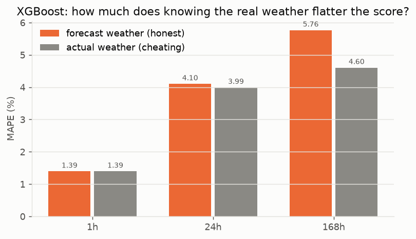
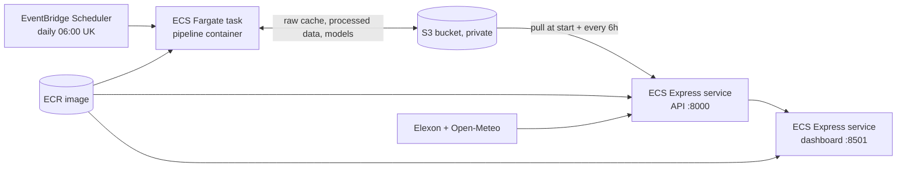

# GB Electricity Demand Forecasting

Forecasts Great Britain's national electricity demand **1 hour, 24 hours and 7 days ahead**,
and compares Prophet, XGBoost and a Temporal Fusion Transformer against a simple
"same hour last week" baseline, using only information that would have been available
at forecast time.

> Status: **complete** — data, backtests for 3 models + baseline, write-up, API, dashboard and Docker.

## 1. Problem

The grid operator has to balance supply and demand every second. Generators are
scheduled hours to days ahead, so demand forecasts at several horizons drive cost and
reliability: an hour ahead for real-time balancing, a day ahead for market scheduling,
a week ahead for planning plant availability.

Success means beating the naive baseline at every horizon **in an honest backtest**:
walk-forward evaluation, no shuffling, and weather *forecasts* (not observed weather)
as inputs.

## 2. Data

| Source | What | Resolution | Range used |
|---|---|---|---|
| [NESO Historic Demand Data](https://www.neso.energy/data-portal/historic-demand-data) | `ND` (National Demand, MW) | 30 min | 2021-01-01 → ~3 weeks ago |
| [Open-Meteo Historical Weather](https://open-meteo.com/en/docs/historical-weather-api) | Reanalysis ("actual") weather | hourly | 2021-01-01 → ~1 week ago |
| [Open-Meteo Previous Runs](https://open-meteo.com/en/docs/previous-runs-api) | Real forecasts at 1–7 day lead times (ECMWF IFS 0.25°) | hourly | 2024-03-13 → yesterday |
| [Open-Meteo Historical Forecast](https://open-meteo.com/en/docs/historical-forecast-api) | First hours of each model run, stitched together (ECMWF IFS 0.25°) | hourly | 2024-03-13 → yesterday |

**What ND is.** National Demand is the demand met by transmission-connected generation.
It *excludes* rooftop and small-scale ("embedded") solar and wind. So on a sunny day,
ND falls even though people use just as much electricity. That makes solar radiation a
genuine demand driver, alongside temperature.

**Weather.** Five cities stand in for their regions and are combined using population
weights: London 0.52, Birmingham 0.16, Manchester 0.16, Glasgow 0.10, Cardiff 0.06.
Variables: temperature, apparent temperature, humidity, wind speed, cloud cover,
precipitation, solar (shortwave) radiation.

**Why three weather sources?** Training on observed weather is fine. But *testing* a
7-day-ahead forecast with the weather that actually happened is cheating, because
nobody knows next week's weather exactly. The Previous Runs API gives what the forecast
said 1, 2, … 7 days before each hour, so the backtest sees realistic weather errors.
The Historical Forecast API sounds like the right tool but isn't: it stitches together
the first few hours of every model run, so it's effectively a 0–6 hour forecast.

| National temperature error vs reanalysis | MAE |
|---|---|
| Historical Forecast API (stitched) | 0.23 °C |
| Forecast made 1 day ahead | 0.39 °C |
| Forecast made 7 days ahead | 1.79 °C |

All forecast sources use **one model (ECMWF IFS 0.25°)**. Open-Meteo's default
"best match" uses the Met Office 2 km model for UK cities. Over London that runs ~0.5 °C
warmer than the reanalysis we train on, an offset that would look like forecast error
but isn't.

### Cleaning decisions

| Issue | What we do | Why |
|---|---|---|
| Settlement periods, not timestamps | Period 1 starts at local midnight; convert local midnight → UTC and add (period − 1) × 30 min | One rule that works for normal days and clock-change days |
| Clock changes (46 / 50 periods) | Store everything in UTC | UTC has no missing or repeated hours; local time is used later only for calendar features |
| Changing date formats across years | Try each known format per file | NESO switched from `01-JAN-2021` to `01-Jan-23` to `2025-01-01` |
| Half-hourly → hourly | Mean of the two half-hours | ND is power (MW), so average it rather than add it up |
| Missing values | Interpolate gaps ≤ 2 h, leave longer gaps missing | Don't invent data the model is then scored on |
| Outliers | Remove only physically impossible values or isolated spikes (>10× the typical half-hour change away from neighbours) | Real extremes (cold snaps, Christmas) are what we need to forecast |
| Radiation/precipitation timestamps | Shift back 1 h | Open-Meteo labels them at the end of the hour; demand hours are labelled at the start |

What the cleaning actually found is in `data/processed/cleaning_report.json` and in the
[exploration notebook](notebooks/01_exploration.ipynb).

## 3. Approach

### What "1h / 24h / 7d ahead" means exactly

A forecast is made at an **origin** time *t*. Horizon *h* is the hour that **ends**
*h* hours later. At 09:00 the newest demand we know is the 08:00–09:00 hour, so:

| Horizon | Forecasting (from 09:00 Mon) | Newest demand it may use | Weather forecast it may use |
|---|---|---|---|
| 1h | 09:00–10:00 Mon | 08:00–09:00 Mon | issued ≥ 1 day before (lead day 1) |
| 24h | 08:00–09:00 Tue | 08:00–09:00 Mon | issued ≥ 2 days before (lead day 2) |
| 168h | 08:00–09:00 next Mon | 08:00–09:00 Mon, i.e. a week before the target | issued 7 days before (lead day 7) |

Every hour in the test period is forecast once **per horizon**, so each horizon is
scored on ~21,000 target hours covering every hour of the day.

### Features

| Group | Features | Leakage rule |
|---|---|---|
| Calendar (UK local time) | hour, weekday, month, weekend, England & Wales bank holiday, Scottish bank holiday, Christmas period, smooth day-of-year | Always known in advance |
| Demand lags | `lag_k` for k ∈ {1, 2, 3, 24, 48, 168, 336} h; 24h and 168h rolling means | Only lags **k ≥ h**; rolling windows end at the newest known hour. The 168h model gets just `lag_168`, `lag_336` and rolling means ending a week back |
| Weather | temperature, wind speed, solar radiation; 24h mean temperature; heating degrees max(0, 15.5 − T); cooling degrees max(0, T − 20) | **Training:** actual weather. **Testing:** the weather forecast that existed at the origin |

**Which weather forecast is legal?** A weather model run becomes available about 8 hours
after it starts. The lead day for horizon *h* is ⌈(h + 8) / 24⌉: day 1 for 1h, day 2 for
24h, and day 8 for 168h. Day 8 doesn't exist, so we cap at day 7. That last case uses a
forecast published up to ~8h after the origin, which is a small optimism we accept and
document. Where a forecast value is missing we fall back to *older* forecasts only.

Wind appears twice in its effect on National Demand. It makes buildings lose heat
faster, and it powers small wind farms that reduce the demand the transmission network
sees.

### Rolling-origin backtest

```
train ─────────────────────────────┤ test Q2-2024
train ──────────────────────────────────┤ test Q3-2024
train ───────────────────────────────────────┤ test Q4-2024     … 10 folds to Sep 2026
```

- Folds are calendar quarters from **April 2024** (when forecast weather begins) to the
  latest data. Each fold retrains on **all data before it** (expanding window, from
  January 2021).
- Folds are split by **forecast origin**. A 7-day forecast made on 30 June belongs to the
  fold that starts in April, even though its target is in July.
- Data is never shuffled. Tests check that changing "future" demand or observed weather
  never changes a feature.
- Metrics per horizon: MAE (MW), RMSE (MW), MAPE (%); plus pinball loss for quantiles.

### Models

All three models run through the same backtest, on the same folds, with the same
legal inputs. Hyperparameters were set up front in `configs/config.yaml`, not tuned on
the test folds, because tuning on the test period would flatter the scores.

| Model | How it forecasts | Uses recent demand? | One model per… |
|---|---|---|---|
| **Prophet** | Smooth trend + daily/weekly/yearly cycles + linear weather and holiday effects. Four daily cycles switch on {GMT, BST} × {working day, day off}, so the winter-weekday and summer-Sunday shapes can differ and clock changes line up | No, so its 1h forecast is no better informed than its 7-day one | fold (shared across horizons) |
| **XGBoost** | Gradient-boosted trees on the feature table. Number of trees picked by early stopping on the last 8 weeks *of the training data*, then refit on everything | Yes, whatever's legal for the horizon | fold × horizon ("direct" strategy) |
| **TFT** (Darts) | Neural network: reads a 1-week look-back of demand and calendar/weather, then forecasts all 168 hours at once, as 10th / 50th / 90th percentiles | Yes, up to the origin | 2 folds (retrained every half-year to fit a laptop) |

**Honest weather for TFT.** TFT forecasts every hour of the coming week at once, but
the weather inputs that are legal depend on the horizon. For horizon *h* we feed the
horizon's legal forecast series for the whole window. TFT's decoder is causal (masked
attention, forward LSTM), so the forecast for step *h* can only use inputs up to step *h*,
and all of those are legal. A test changes later inputs and confirms the step-*h*
forecast doesn't move.

**Compute.** No GPU. On a 4-core laptop CPU the full backtests take about 7 min
(XGBoost), 15 min (Prophet) and 2.3 h (TFT). See [Running TFT faster](#running-tft-faster).

### Baseline: same hour last week

ŷ(Tue 18:00) = demand at the previous Tue 18:00. It gets the daily and weekly shape right
for free and is legal at every horizon up to 7 days. Its accuracy is the same at every
horizon, because it ignores everything newer than a week. So any gain at 1h and 24h has
to come from the models using fresher information.

## 4. Architecture



## 5. Results

Backtest: April 2024 – September 2026, 10 quarterly folds, ~21,000 forecasts per
horizon. All test-time weather is **forecast** weather. Best model per horizon in bold.
Full tables: [reports/results.md](reports/results.md).

| Horizon | Model | MAE (MW) | RMSE (MW) | MAPE | Skill vs baseline | Pinball q10 / q90 (MW) | 80% interval coverage |
|---|---|---|---|---|---|---|---|
| 1h | Same hour last week | 2,057 | 2,781 | 8.17% | 0% | – | – |
| 1h | Prophet | 1,447 | 1,823 | 5.98% | 30% | – | – |
| 1h | **XGBoost** | 343 | 453 | 1.39% | 83% | – | – |
| 1h | TFT | 1,032 | 1,329 | 4.25% | 50% | 231 / 254 | 68% |
| 24h | Same hour last week | 2,053 | 2,775 | 8.15% | 0% | – | – |
| 24h | Prophet | 1,472 | 1,856 | 6.08% | 28% | – | – |
| 24h | **XGBoost** | 991 | 1,348 | 4.10% | 52% | – | – |
| 24h | TFT | 1,021 | 1,330 | 4.22% | 50% | 246 / 240 | 64% |
| 168h | Same hour last week | 2,053 | 2,777 | 8.15% | 0% | – | – |
| 168h | Prophet | 1,844 | 2,392 | 7.52% | 10% | – | – |
| 168h | **XGBoost** | 1,405 | 1,907 | 5.76% | 32% | – | – |
| 168h | TFT | 1,510 | 2,049 | 6.04% | 26% | 391 / 472 | 49% |

*Skill vs baseline* = how much smaller the MAE is than "same hour last week".









### How much does "cheating" with real weather flatter the score?

The same XGBoost backtest, scored with the weather that actually happened instead of
the forecast that was available at the time:

| Horizon | MAPE, forecast weather (honest) | MAPE, actual weather (cheating) | Score flattered by |
|---|---|---|---|
| 1h | 1.39% | 1.39% | 0% |
| 24h | 4.10% | 3.99% | 3% |
| 168h | 5.76% | 4.60% | **20%** |



## 6. Key findings

1. **XGBoost wins at every horizon**: 83% / 52% / 32% lower error than the baseline at
   1h / 24h / 7d. It's also the fastest model to train (~10 s per model on a laptop).
2. **Recent demand is everything at short horizons.** XGBoost's 1h model puts 77% of its
   gain on last hour's demand and reaches 1.39% MAPE. Prophet has no lag inputs, so it
   stays at ~6% whether forecasting 1 hour or 1 day ahead.
3. **TFT is competitive at 24h (4.22% vs 4.10%) but not at 1h (4.25%).** One network
   that forecasts all 168 steps, lightly trained to fit a CPU budget, doesn't exploit the
   last hour the way a dedicated 1h model does. More training (GPU) might close some of
   that gap.
4. **TFT's 80% intervals are too narrow**: they catch 68% / 64% / 49% of actual values.
   It trained on actual weather, so it never learned that weather forecasts can be
   wrong, and the gap is worst at 7 days, where forecasts are worst. Training on archived
   forecasts, or calibrating intervals on recent errors, would fix this.
5. **Testing with real weather flatters 7-day scores by 20%.** At 1h it makes no
   difference, because lags dominate. Many published demand-forecast results use
   observed weather; this shows why that's misleading for longer horizons.
6. **Errors peak at midday (12:00–14:00) for every model.** Rooftop solar output hides
   demand from the grid, and cloud cover is hard to forecast, so midday is the most
   uncertain time of day. Evening peaks are easier.
7. **Hardest days**: cold snaps, bank holidays, Easter, clock-change weekends, and the
   end of the June 2026 heatwave.

## 7. Limitations

- Honest (forecast-weather) evaluation can only start in March 2024, when Open-Meteo's
  archive of 1–7 day forecasts begins, so the test covers ~2.5 years.
- Five cities are a coarse proxy for national weather, especially for solar and wind.
- All models train on actual weather and are tested on forecast weather. That's
  realistic, but the models never learn how far to trust a 7-day-old forecast.
- The 168h horizon uses a weather forecast published up to ~8h after the origin
  (no older one exists in the archive), so it's slightly optimistic.
- Hyperparameters are sensible defaults, not tuned (deliberately, to avoid tuning on the
  test period). A proper tuning set before April 2024 could improve all models.
- TFT was sized for a laptop CPU (4 epochs, 20k windows, retrained half-yearly); a GPU
  run could change its ranking.
- Live demand after NESO's file comes from Elexon's *initial* outturn, which can be
  revised slightly later.

## 8. How to run

Requires [uv](https://docs.astral.sh/uv/). uv installs Python 3.12 automatically.

```bash
uv sync --all-extras    # core + research (Prophet, Darts/PyTorch) + serve (FastAPI, Streamlit)
uv run python -m demand_forecast.data.download_demand   # ~30 s
uv run python -m demand_forecast.data.download_weather  # ~10 min (free-tier rate limits)
uv run python -m demand_forecast.data.clean
uv run python notebooks/build_exploration.py            # builds + runs the notebook
uv run python -m demand_forecast.evaluation.backtest --model baseline
uv run pytest
```

Downloads are cached in `data/raw/`. Re-running only refreshes the current year.

Model backtests (run one at a time; they compete for CPU):

```bash
uv run python -m demand_forecast.evaluation.backtest --model xgboost   # ~7 min
uv run python -m demand_forecast.evaluation.backtest --model prophet   # ~15 min
uv run python -m demand_forecast.evaluation.backtest --model tft       # ~2.3 h on CPU
uv run python -m demand_forecast.evaluation.backtest --model xgboost --weather actual  # "cheating" run
uv run python -m demand_forecast.evaluation.report                     # tables + charts
```

### Running TFT faster

TFT doesn't *need* a GPU, but a CPU makes it slow: about 27 min per training run here.
Retraining every half-year instead of every quarter halves that to 5 runs. Options,
cheapest first:

1. **Stay on CPU, train less**: fewer windows/epochs in `config.yaml → models.tft`.
   Fast, but may underfit.
2. **Kaggle Notebooks / Google Colab**: free NVIDIA T4. Clone the repo, `pip install -e .`,
   upload `data/processed/`, and set `models.tft.accelerator: gpu`. Expect several times
   faster training (not measured here). Kaggle offers a weekly free GPU quota.
3. **AWS `g4dn.xlarge`** (T4): roughly $0.5/h on-demand and less on spot. A full TFT
   backtest should cost around a dollar.

## 9. Serving

**What runs in production:** XGBoost, the best model at every horizon. It's a "direct"
model (one per horizon), so we train five horizons (1, 6, 24, 72, 168 h). Hour *h* of the
weekly forecast uses the smallest trained horizon ≥ *h*. That model only reads demand
older than the forecast start, so no hour can leak.

**Fresh demand:** NESO's file is ~3 weeks behind, which is useless for a 1h forecast.
The API tops it up with Elexon's *Initial National Demand Outturn*, published within
~30 minutes. Over 1,200 overlapping half-hours it matched NESO ND to 0.10% on average,
so it's treated as the same series. NESO's settled values win wherever both exist.

**Weather:** Open-Meteo's live forecast, using the same ECMWF model as the backtest.

| Endpoint | Returns |
|---|---|
| `GET /forecast` | next 168 hourly forecasts (MW), origin time, model training date. Cached 30 min |
| `GET /actuals?days=14` | recent hourly demand |
| `GET /metrics` | backtest scores for every model and horizon |
| `GET /health` | model status |

```bash
uv sync --all-extras
uv run python -m demand_forecast.serving.production       # train production models (~2 min)
uv run uvicorn demand_forecast.serving.api:app --reload   # http://localhost:8000/docs
uv run streamlit run dashboard/app.py                     # http://localhost:8501
```

With Docker (needs `data/processed/` and `artifacts/models/` from the steps above, or run
the pipeline container first):

```bash
docker compose run --rm pipeline   # download, clean, retrain
docker compose up --build          # API :8000, dashboard :8501
```

The image installs only the `serve` extra (1.2 GB; Prophet, Darts and PyTorch stay out).
Tested: `docker compose up` serves a live 168-hour forecast and the dashboard, and the
`pipeline` container refreshes data and retrains.

### Deploying on AWS

> **Why not App Runner?** It was the obvious choice, but AWS
> [closed App Runner to new customers on 30 April 2026](https://docs.aws.amazon.com/apprunner/latest/dg/apprunner-availability-change.html).
> AWS's recommended replacement is **ECS Express Mode**: one command per service gives an
> HTTPS URL, a load balancer and autoscaling, without writing load-balancer config.



- **One image, three roles:** API, dashboard and the daily `pipeline` job all run the same
  ECR image with different commands.
- **State lives in S3:** containers are disposable. Set `ARTIFACT_BUCKET` and
  [`storage.py`](src/demand_forecast/serving/storage.py) syncs models and data. The pipeline
  pulls the raw-data cache (so downloads stay incremental), retrains and pushes. The API
  pulls at start-up and every 6 hours, and hot-swaps the model when a new one appears.
- **Least privilege:** the containers' role can only read and write this one bucket.

**Deploy** (from Git Bash, with Docker running):

```bash
aws configure                      # your credentials; needs AWS CLI v2 recent enough for Express Mode
REGION=eu-west-2 ./deploy/aws/deploy.sh
```

[`deploy/aws/deploy.sh`](deploy/aws/deploy.sh) creates or reuses the S3 bucket, ECR repo,
IAM roles, both Express services and the daily schedule, then prints the URLs. Re-running
it redeploys. [`deploy/aws/teardown.sh`](deploy/aws/teardown.sh) removes everything, after
asking you to confirm.

**Cost:** two always-on Fargate services (1 vCPU / 2 GB) plus a load balancer come to
roughly **$90–110/month**; the daily retrain and S3 cost cents. For a portfolio demo,
deploy, take screenshots, and tear down, or shrink the dashboard task.

> The deploy scripts are syntax-checked but **haven't been run against a real AWS account**
> (no credentials were available while building this). Expect to fix small issues on the
> first run.

## Roadmap

1. ✅ Setup and data
2. ✅ Features and baseline
3. ✅ Models (Prophet, XGBoost, TFT)
4. ✅ Evaluation and write-up
5. ✅ Serving (FastAPI, Streamlit, Docker; image tested); AWS deploy script ready, not yet run

## Data licences

NESO data is used under the NESO Open Data Licence. Weather data is from
[Open-Meteo](https://open-meteo.com/) (CC BY 4.0), used under its free non-commercial terms.
